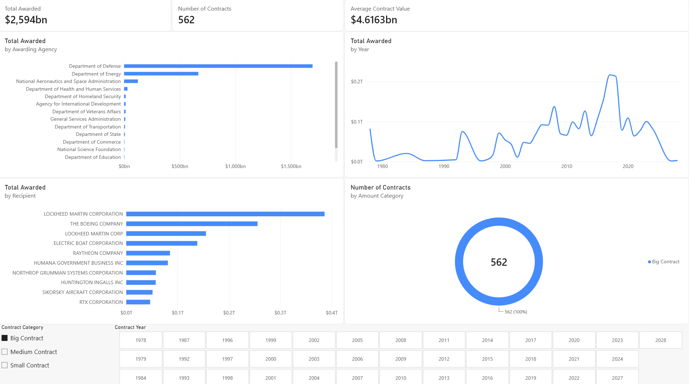

# US Federal Spending ETL & Analytics Pipeline 📊

## Project Overview
This overall simple project demonstrates a complete, end-to-end Data Engineering pipeline. It extracts federal contract data from the **USASpending.gov API**, processes it using **Python**, stores it in a **SQL Server** data warehouse, and visualizes key business insights through an interactive **Power BI** dashboard.

The goal is to analyze US government spending patterns focusing on contract magnitudes, awarding agencies, and top recipients.

---

## 🏗️ System Architecture
The pipeline follows the classic **ETL (Extract, Transform, Load)** pattern:

*   **Extract:** Automated data retrieval from a REST API with pagination handling.
*   **Transform:** Data cleaning, type casting, and business logic enrichment (e.g., contract size categorization).
*   **Load:** Efficient data transfer into a structured SQL Server database using SQLAlchemy.
*   **Visualize:** Interactive reporting in Power BI using advanced DAX measures and data modeling.

---

## 🛠️ Tech Stack
*   **Language:** Python 3.13
*   **Libraries:** Pandas, SQLAlchemy, Requests, PyODBC
*   **Database:** SQL Server (SSMS)
*   **BI Tool:** Power BI (DAX)

---

## 🚀 Key Features

### 1. Robust Python ETL Pipeline
*   **Risk Mitigation:** Includes a "Step 0" connectivity check to ensure the database is reachable before starting API calls.
*   **Pagination Logic:** Automatically handles multi-page API responses to fetch full datasets.
*   **Alternative Auth:** Supports both Windows Authentication (Local) and SQL Server Authentication (Production/Cloud).

### 2. Data Enrichment (Business Logic)
The script creates new dimensions beyond raw data:
*   **Contract Categorization:** Automatically flags contracts as "Big", "Medium", or "Small" based on financial thresholds.
*   **Time Intelligence:** Deconstructs dates into Years and Months for granular trend analysis.

### 3. SQL Data Warehousing
*   Data is stored in a clean `Fact_Awards` table.
*   Optimized for BI ingestion with appropriate data types for financial values and dates.

### 4. Interactive Power BI Dashboard
The report answers four fundamental business questions:
*   **How much?** (KPI Cards for Total Spent, Avg Award, and Total Count)
*   **Who gives?** (Analysis of Awarding Agencies)
*   **Who receives?** (Top Recipients by value and contract count)
*   **When?** (Timeline trend analysis)

---

## 📈 Dashboard Preview


---

## 🔢 DAX Measures Implemented
To provide deeper insights, the following DAX measures were created:

```dax
Total Awarded = SUM(Fact_Awards[award_amount])

Number of Contracts = COUNTROWS(Fact_Awards)

Avg Contract Value = [Total Awarded] / [Number of Contracts]

% of Total = DIVIDE([Total Awarded], CALCULATE([Total Awarded], ALL(Fact_Awards)))
